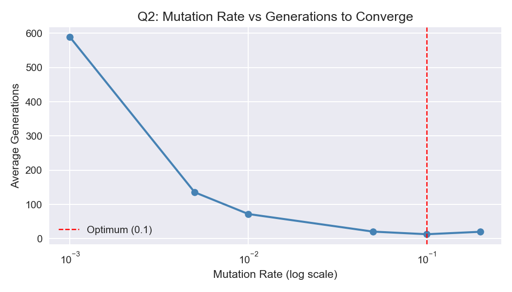
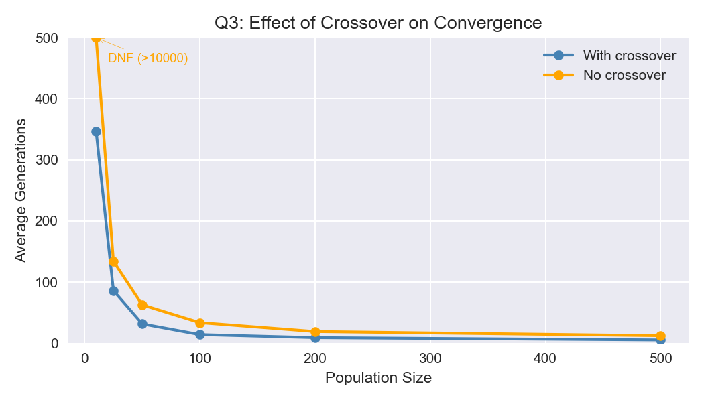
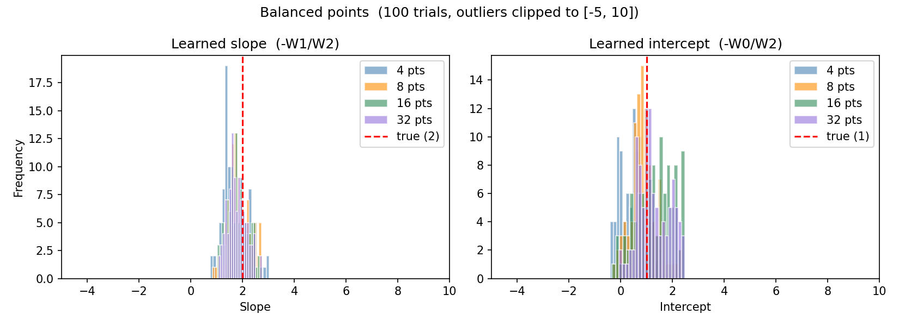

# Genetic Algorithm & Perceptron from Scratch (Java)

Two practical assignments for **Computational and Cognitive Neuroscience** (KEN1210, BSc Data Science & AI, Maastricht University, 2026), done as a pair with Matvei Kandalintsev. Both are written in plain Java with no libraries, with Python scripts for the experiment plots.

## 1. Genetic algorithm — evolving "HELLO WORLD"

[`genetic-algorithm/`](genetic-algorithm)

A GA that evolves random 11-character strings into `HELLO WORLD` (27-symbol alphabet, fitness = characters in the right position).

- Parents drawn from the top-10 individuals, two-point crossover, per-character mutation, and elitism (top 10 copied unchanged)
- Experiments averaged over 10 runs with a 10,000-generation cap:

| Experiment | Finding |
|---|---|
| Population size | Larger is faster, with diminishing returns: 347 generations at size 10 down to about 6 at size 500 |
| Mutation rate | Clear optimum around 0.1 (about 13 generations); 0.001 needed about 590, and 0.2 got slower again |
| No crossover | Slower at every population size; size 10 never solved it |
| No mutation | Never solved: crossover can only recombine characters already present in the population |

```bash
cd genetic-algorithm
javac *.java && java PracticalGAs
python3 plots/visualise.py
```

<p> </p>

## 2. Perceptron — AND and a linear boundary

[`perceptron/`](perceptron)

A single-layer perceptron (2 inputs + bias, step activation, perceptron learning rule) with an optional verbose mode that prints every weight update.

- **AND:** reproduces the lecture's worked example step by step (same starting weights and learning rate): converges in 4 passes with 3 updates
- **y = 2x + 1:** learns to classify points as above or below the line from random initial weights
- **More training points:** over 100 random-initialisation trials, more balanced points shrink the spread of the learned slope (standard deviation 0.49 with 4 points, 0.36 with 32). Very unbalanced 4-point sets are unstable, but from 8 points onward they settle near the true line

```bash
cd perceptron
javac *.java
java ExperimentAND --verbose
java ExperimentLinear --verbose
python3 plot_passes.py
```

<p></p>

## Who did what

Matvei wrote most of the genetic algorithm code; I wrote the GA report and documentation. I wrote the perceptron code, experiments and plots.
<!-- TODO(Minseok): add how the reports were split, if you want to -->

## AI usage

As declared in our submissions: the Python plotting scripts and the extended 8/16/32-point datasets were written with help from Claude. The algorithms, experimental design and analysis are our own.
